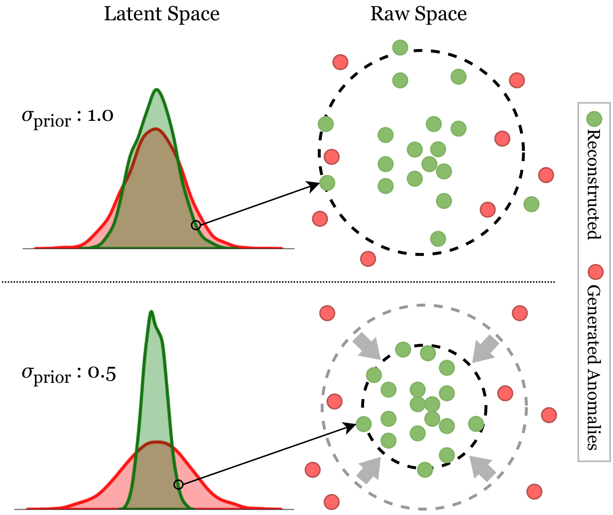
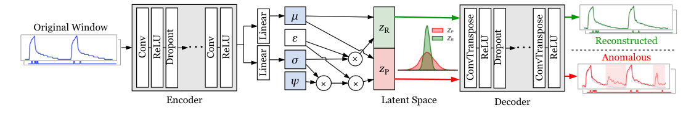
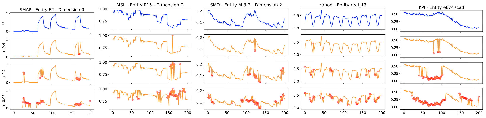

# GenIAS: Generator for Instantiating Anomalies in Time Series
Z Z Darban, Q Wang, G. I. Webb, S. Pan, C. C. Aggarwal, and M. Salehi

**Accepted at WSDM 2027.**

[arXiv preprint](https://arxiv.org/abs/2502.08262) · [PDF](https://arxiv.org/pdf/2502.08262) · [Citation](#citation)

## Overview

GenIAS generates synthetic anomalies for time series anomaly detection (TSAD). It learns normal temporal patterns with a Temporal Convolutional Network–Variational Autoencoder (TCN-VAE), then introduces learned perturbations in latent space to produce diverse, context-aware anomalies.

This repository contains code for training GenIAS, generating and visualizing anomalies, and comparing anomaly generation methods.

## How GenIAS Works

### Core Idea

GenIAS jointly learns a compact representation of normal windows and a perturbation scale. Compact KL regularization reduces overlap between normal and anomalous representations, while a perturbation loss balances distinguishability and realism.

<p align="center">
  
</p>

### End-to-End Pipeline

1. **Encode:** Map a normal time series window to a latent Gaussian distribution using the TCN encoder.
2. **Perturb:** Scale the latent standard deviation with a learned factor while keeping the mean fixed.
3. **Decode:** Reconstruct the normal window and decode the perturbed sample into an anomalous candidate.
4. **Patch:** Apply deviation-based patching to inject anomalous components while preserving normal context.
5. **Use:** Supply the synthetic anomalies to a downstream TSAD model for training.

<p align="center">
  
</p>

See the [paper](https://arxiv.org/abs/2502.08262) for the learning objective and patching procedure.

### Sample Output



The top row shows original windows in blue. The remaining rows show generated samples in orange, with modified points marked in red, for different patching thresholds (`tau = 0.4`, `0.2`, and `0.05`). The examples illustrate changes in the extent and location of injected anomalies.

## Installation

Clone the repository and install its dependencies:

```sh
git clone https://github.com/zamanzadeh/GenIAS.git
cd GenIAS
pip install -r requirements.txt
```

For the notebooks, install Jupyter if it is not already available:

```sh
pip install notebook
```

## Data Preparation

Datasets and trained checkpoints are not included in this repository. Before training, prepare the dataset files and adjust the paths in the scripts to match your local setup.

For MSL, `genias_train.py` currently expects the following paths, relative to the directory from which you run it:

```text
../../datasets/MSL_SMAP/
├── labeled_anomalies.csv
└── train/
    ├── <channel_id>.npy
    └── ...
```

The training script reads the MSL channel IDs from `labeled_anomalies.csv` and loads each corresponding training array. Its current dataset option implements MSL; the `other` option is a placeholder for adapting the script to additional datasets.

For evaluation data formats and paths, see [evaluation/ts_loader.py](evaluation/ts_loader.py).

## Usage

### Train GenIAS

Run the training script from the repository root. For example, to train on MSL:

```sh
python genias_train.py \
  --dataset msl \
  --epochs 1000 \
  --learning_rate 0.0001 \
  --window_size 200 \
  --batch_size 100 \
  --hid_size 200 \
  --latent_dim 100
```

Use `--savedir` to configure the checkpoint directory. To view all available arguments:

```sh
python genias_train.py --help
```

### Generate and Visualize Anomalies

Open the inference notebook:

```sh
jupyter notebook genias_inference.ipynb
```

Set the data and checkpoint paths in the notebook to match your local files before running its cells.

### Evaluate Anomaly Generation

The evaluation scripts compare GenIAS with CARLA, COUTA, CutAddPaste, and NCAD. Review their dataset lists, data paths, and model paths before running them.

Generate anomalous samples and their representations:

```sh
python evaluation/get_representations.py
```

Compute generation metrics:

```sh
python evaluation/get_gen_metrics.py
```

Visualize the comparisons:

```sh
jupyter notebook evaluation/gen_metrics_vis.ipynb
```

## Directory Structure

```text
├── README.md
├── requirements.txt
├── genias_train.py          # Training script
├── genias_inference.ipynb   # Inference and visualization notebook
├── losses.py               # Loss functions
├── models.py               # Model definitions
├── train_utils.py          # Training utilities
├── figs/                   # Method illustrations and sample outputs
│   ├── genias_idea.png
│   ├── genias_arc.png
│   └── anomalous_samples.png
└── evaluation/             # Evaluation scripts and notebooks
    ├── deepsvdd_adv.py
    ├── gen_metrics.py
    ├── gen_metrics_vis.ipynb
    ├── get_gen_metrics.py
    ├── get_representations.py
    ├── injection_models.py
    ├── representations.py
    └── ts_loader.py
```

## Citation

If you use GenIAS in your research, please cite the [arXiv preprint](https://arxiv.org/abs/2502.08262):

```bibtex
@misc{darban2025genias,
  title         = {{GenIAS}: Generator for Instantiating Anomalies in Time Series},
  author        = {Zamanzadeh Darban, Zahra and Wang, Qizhou and Webb, Geoffrey I. and Pan, Shirui and Aggarwal, Charu C. and Salehi, Mahsa},
  year          = {2025},
  eprint        = {2502.08262},
  archivePrefix = {arXiv},
  primaryClass  = {cs.LG},
  doi           = {10.48550/arXiv.2502.08262},
  url           = {https://arxiv.org/abs/2502.08262}
}
```

## License

This project is licensed under the MIT License.
